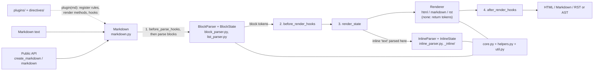

# Mistune Architecture

This document describes mistune v3.4.0 at commit `f7ec702edfc1ad5579a76f881238841af266d93c` (source in `src/mistune/`).

mistune converts Markdown into HTML, Markdown, reStructuredText, or a list of plain-dict tokens (an AST). It has no runtime dependencies (`pyproject.toml:5`). A `Markdown` instance coordinates block parsing, inline parsing, hooks and rendering; plugins extend syntax or transform tokens at defined points.

## 1. Overview

### 1.1 Components

| # | Component | Files | Job |
|---|-----------|-------|-----|
| 1 | **Public API** | `__init__.py` | `create_markdown()` picks a renderer (`"html"`, `"ast"`, or an instance), builds an `InlineParser`, resolves plugins, and returns a `Markdown`. `markdown()` is a cached convenience wrapper; `html` is a ready-made instance. |
| 2 | **Coordinator** | `markdown.py` | `Markdown` owns one `BlockParser`, one `InlineParser`, an optional renderer, and three hook lists. `parse()` also normalizes line endings and returns both the output and the `BlockState`. |
| 3 | **Core types** | `core.py` | `BlockState` and `InlineState` (cursor, tokens, shared `env`), the generic `Parser` (ordered rule registry and regex compilation), and `BaseRenderer` (dispatch by token type). |
| 4 | **Block parser** | `block_parser.py`, `list_parser.py` | Recognises headings, fenced and indented code, quotes, lists, HTML blocks, reference definitions and blank lines. Lists are delegated to `list_parser.parse_list`. Nested containers create child states that share the root `env` (used for reference links). Paragraph and heading content is left unparsed under the token key `"text"`. |
| 5 | **Inline parser** | `inline_parser.py`, `_inline/` | Turns each `"text"` into inline tokens: escapes, code spans, emphasis, links, autolinks, inline HTML, line breaks. Bracket/link handling and delimiter scanning live in `_inline/`. |
| 6 | **Renderers** | `renderers/html.py`, `markdown.py`, `rst.py`, `_list.py` | Walk the token tree and produce output. All subclass `BaseRenderer`. `HTMLRenderer` centralizes escaping, attribute rendering and URL-protocol policy. `_list.py` holds list helpers shared by the Markdown and RST renderers. |
| 7 | **Plugins and directives** | `plugins/`, `directives/`, `toc.py` | A plugin is a callable `plugin(md)` that adds grammar rules, render methods and/or hooks. Directives (`.. name::` and fenced styles) are a plugin framework built on the same mechanism. Built-in plugins are mapped from names to import paths in `plugins/__init__.py`. |
| 8 | **Support** | `helpers.py`, `util.py` | Shared regexes and link parsing (`helpers.py`); escaping, URL and string utilities (`util.py`). |

### 1.2 Flow and call structure

Inline parsing is lazy: `Markdown._iter_render` parses each token's `"text"` only when `render_state` runs, which is after the `before_render_hooks`. Those hooks therefore see block tokens whose inline content is not yet parsed.

## 2. Architecture Decision Records

### ADR-1: Parsing produces renderer-independent tokens

**Status: Verified.** `Markdown.parse` is documented to return parsed tokens when the renderer is `None` (`markdown.py:71-73`, docstring), and `create_markdown` maps `renderer="ast"` to `None` (`__init__.py:48-50`).

- **Context:** One syntax tree must serve HTML, Markdown re-formatting, RST, and user tools that want the tree.
- **Decision:** Every token is a `dict` with a `"type"` and some of `"raw"` (literal content), `"text"` (inline content still to be parsed), `"children"` (token list) and `"attrs"` (dict). Parsers only produce tokens; renderers only consume them.
- **Alternatives considered:** Parsers emitting HTML directly as they match; separate parsers per output format. (Reconstructed from the code, not documented by the authors.)
- **Consequences:** Plugins can work at token level and renderers share parsing behavior. Token names and keys are a de-facto public contract between parsers, plugins and renderers, with weak typing (`Dict[str, Any]`).

### ADR-2: Syntax is an ordered, named, regex-driven rule registry

**Status: Verified.** The `Parser.register` docstring says it is the usual way to create a plugin and supports `before=` (`core.py:214-225`); the 3.4.0 history has perf work on this machinery (`git log`, e.g. `56cd21e perf: streamline inline parsing and unify nesting limits`).

- **Context:** The parser must be fast in pure Python while letting plugins add syntax without copying the core.
- **Decision:** Each parser has a `SPECIFICATION` (name to regex) and an ordered `rules` list. `compile_sc` joins the active rules into one `(?P<name>...)|...` regex (`core.py:209`), cached by rule list. The matched group name selects a handler that returns the new cursor position, or a falsy value to fall back to paragraph/text. `register(name, pattern, func, before=...)` inserts a rule before a named one and clears the cache.
- **Alternatives considered:** A hand-written character-by-character state machine; one regex per rule tried in sequence. (Reconstructed.)
- **Consequences:** Rule order is behavior, since it decides which syntax wins. If `before=` names a rule that is not in the list, the new rule is silently appended (`core.py:240-248`). For example `"paragraph"` is not a block rule, so `before="paragraph"` (used by the table and abbr plugins) means "append". Inline parsing has extra fast-path machinery (`start_chars`) to limit scanning cost.

### ADR-3: Extensions are callables applied to one `Markdown` instance

**Status: Inferred.** The structure is visible in `plugins/__init__.py` and every `plugins/*.py`; no commit message or issue was found that states the rationale.

- **Context:** Users want to enable features per instance (`plugins=["table", "footnotes"]`) without forking or mutating global state.
- **Decision:** A plugin is `Callable[[Markdown], None]` (the `Plugin` protocol). It mutates only that instance: `md.block.register`, `md.inline.register`, `md.renderer.register` (guarded by `md.renderer.NAME == "html"`), and the three hook lists (`before_parse_hooks`, `before_render_hooks`, `after_render_hooks`) for document-wide passes such as `task_lists`, `footnotes` and TOC. Built-ins are loaded lazily by name from the `_plugins` table; any `"module.func"` string or callable also works.
- **Alternatives considered:** Subclassing `Markdown` or the parsers per feature; global registries; monkey-patching. (Inferred.)
- **Consequences:** Features compose and stay isolated per instance. Plugin render methods are registered only for the HTML renderer; `MarkdownRenderer` and `RSTRenderer` implement their own methods (e.g. `table`, `strikethrough`). Plugin order can matter because rule order matters (ADR-2).

## 3. Constraints

Rules to preserve when changing the code. Each names where it can be seen.

1. **Keep the token contract and give every token type a renderer method.** Use `"raw"` for literal text, `"text"` for content that `Markdown._iter_render` must still run through the inline parser, `"children"` for nested tokens, and `"attrs"` for parameters. A renderer looks up a method named after `token["type"]`; a missing method raises `AttributeError`. `HTMLRenderer` methods receive rendered child text plus `attrs` as keyword arguments (`func(text, **attrs)`), while `MarkdownRenderer` and `RSTRenderer` methods take `(token, state)`. *See `markdown.py` `_iter_render`, `core.py` `BaseRenderer._get_method`, `renderers/html.py` `render_token`, `renderers/markdown.py`, `plugins/task_lists.py`.*
2. **Extend through `plugin(md)`, the `register` APIs and the matching hook phase.** Add syntax with `md.block.register` / `md.inline.register` (choose precedence deliberately; `before=` must name an existing rule), render methods with `md.renderer.register`, and document-wide passes with `before_parse_hooks`, `before_render_hooks` or `after_render_hooks` according to what the pass needs (raw source, block tokens before inline parsing, or final output). Never patch classes or module globals, and add a new built-in plugin to the `_plugins` table so it loads by name. *See `core.py` `Parser.register`, `markdown.py` `parse`, `plugins/__init__.py`, `plugins/table.py`.*
3. **Keep the import layering.** `core.py` imports only `_inline/delimiters` at runtime. Plugins, directives and renderers must not import `block_parser.py`, `inline_parser.py` or `markdown.py` at runtime (these are `TYPE_CHECKING`-only imports), and parsers must not import renderers or plugins. *See `core.py`, `plugins/*.py`, `directives/_base.py`, `renderers/html.py`.*
4. **Route HTML output through the renderer's safety helpers.** Escape text with `escape_text` / `safe_entity`, pass URLs through `sanitize_url` / `safe_url` (unsafe schemes become `#harmful-link`), and build attributes with `render_attrs`, which validates names and escapes values. Do not concatenate unescaped content into HTML. *See `renderers/html.py`, `util.py`; `tests/test_security_*.py`.*
5. **Respect the shared nesting limit in recursive code.** `DEFAULT_MAX_NESTED_LEVEL` (20) bounds block containers, lists, directives, links and inline nesting; recursive parsing must stop or fall back to literal text at the limit instead of recursing without bound. When one parser is created from the other, the limit carries over. *See `core.py:28`, `block_parser.py` `parse_block_quote`, `list_parser.py`, `directives/_base.py`, `inline_parser.py`, `_inline/links.py`, `markdown.py:32-35`.*