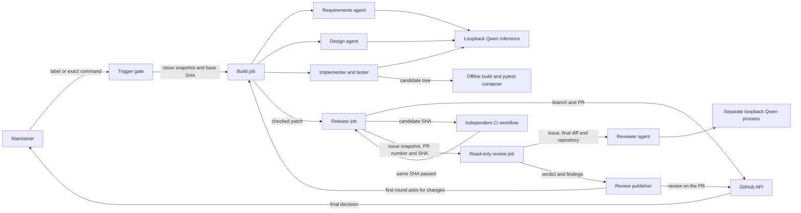

# Component view

The workflow controls retries and permissions. Agents return structured data. The implementer proposes file contents, and the runner applies them under an allowlist. Release and review publication use separate jobs with the GitHub permissions for their specific operation.
