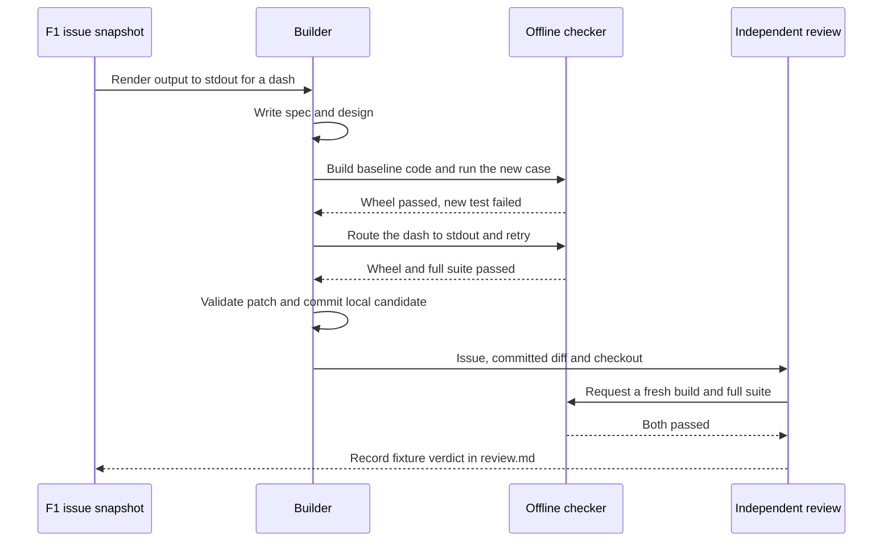

# Sequence view

The diagram shows the local F1 probe. It uses authored model responses and the same checks as the workflow. The hosted issue, Actions run and review links belong in the [run ledger](../../results/runs.md).

A hosted run inserts the release job between builder and review. The release job validates the patch again, pushes the branch, opens a PR, and waits for same-commit CI. A separate publisher posts the reviewer verdict on the PR.
