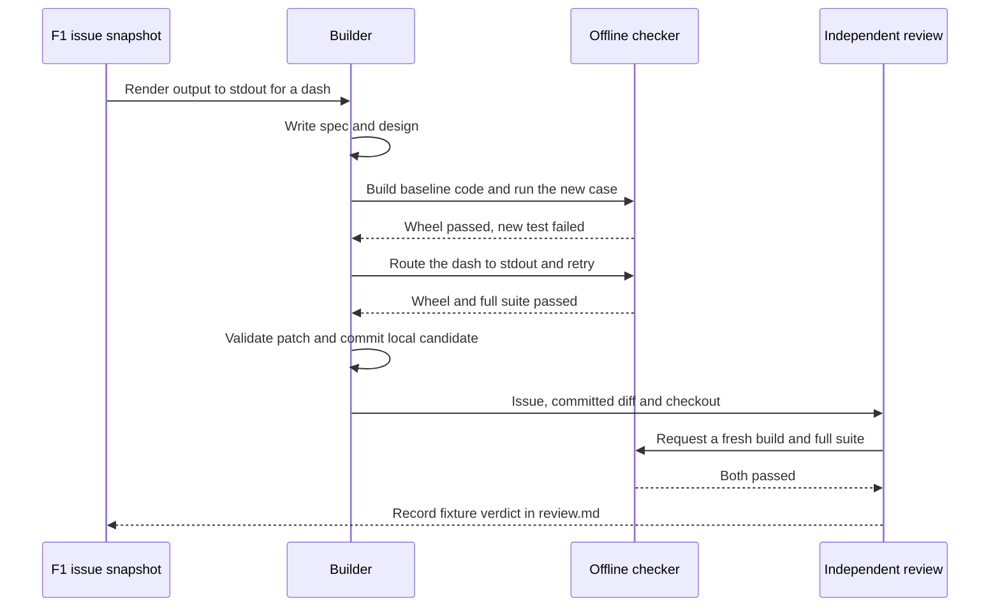
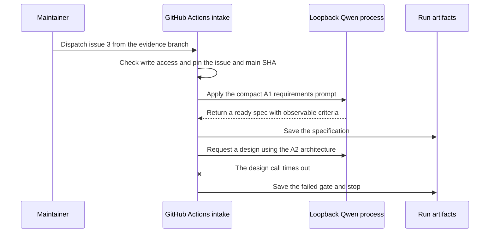

# Sequence view

The diagram shows the local F1 probe, which used authored model responses and the same checks as the workflow. F1 is the original stdout-dash issue #3 and the active demo input. [Run ledger](../../results/runs.md)

A hosted run inserts the release job between builder and review. The release job validates the patch again, pushes the branch, opens a PR, and waits for same-commit CI. A separate publisher posts the reviewer verdict on the PR.

## Hosted F1 attempt

The hosted release and review jobs were skipped. The separate reviewer comparison completed for all five seeded PRs. [F1 Actions run](https://github.com/khush2520/mistune/actions/runs/44836017315) · [Seeded reviewer Actions run](https://github.com/khush2520/mistune/actions/runs/44787096358)
